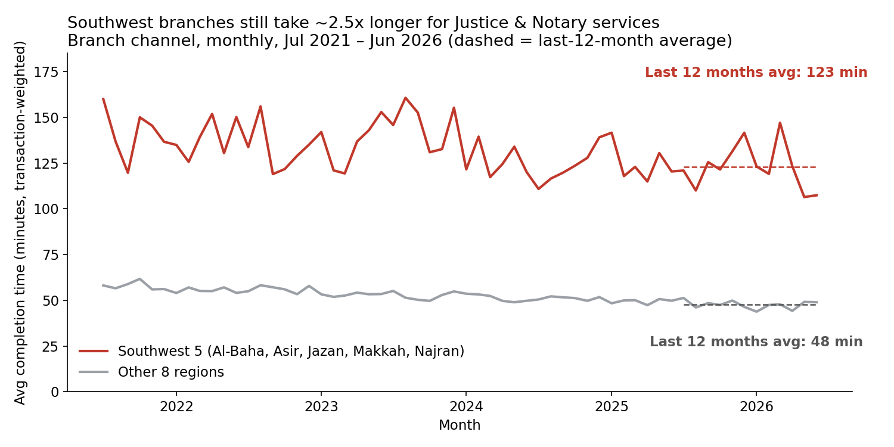
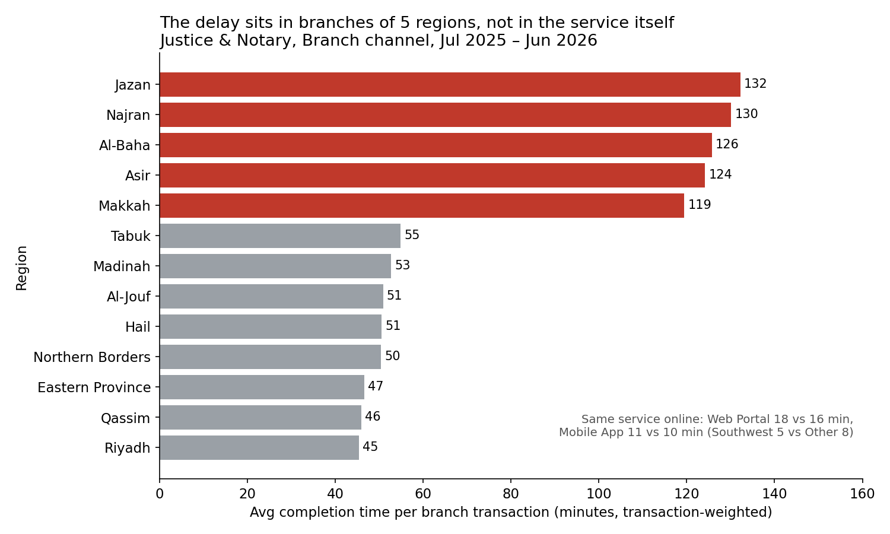

# Justice & Notary Branch Delays in Five Southwest Regions

**Course:** Data Visualization and Storytelling
**Student:** Amro Alamro
**SDAIA Academy:** https://github.com/SDAIAAcademy

## Project description

A short visual story built on `tayseer_services.csv` (Jul 2021 – Jun 2026) that shows where in-person Justice & Notary service is slowest and recommends where to start a branch-process audit.

## Audience, question, scope

- **Audience:** Tayseer service-operations director, working with Ministry of Justice branch operations.
- **Decision question:** Which regions' Justice & Notary branches should be audited first to cut completion time?
- **Scope:** Service category `Justice & Notary`, channel `Branch`, all 13 regions, monthly Jul 2021 – Jun 2026. Headline figures use the latest 12 months (Jul 2025 – Jun 2026).

## Metric and aggregation

- `avg_completion_min` is already an average per row, so every group figure is a **transaction-weighted mean**: sum(avg_completion_min × transactions) ÷ sum(transactions). `csat` is weighted the same way.
- Complaints are summed and divided by summed transactions (per 10,000 transactions).
- `digital_adoption_pct` repeats across the four channel rows, so it is de-duplicated to one value per month × region × category before averaging; it is never summed.

## Charts

## Story

**Finding.** Justice & Notary branch visits in five regions (Al-Baha, Asir, Jazan, Makkah, Najran) take about 2.6 times longer than in the other eight.

**Evidence.**
- Jul 2025 – Jun 2026: 123 min per branch transaction in these five regions vs 48 min in the other eight, across 847,990 branch transactions in the five regions.
- The gap has held every month since Jul 2021 (monthly ratio between 2.0x and 3.1x). It narrowed only slightly, from 140 vs 57 min in the first 12 months to 123 vs 48 min in the latest 12.
- The same service online shows almost no regional gap: Web Portal 18 vs 16 min, Mobile App 11 vs 10 min. So the delay is specific to branches, not to the service.
- Branch customers in the five regions are also less satisfied (CSAT 3.18 vs 3.50 out of 5) and complain more (13.4 vs 11.2 per 10,000 transactions).

**Recommended action.** Audit Justice & Notary branch processes in the five regions, starting with Makkah (largest volume, 509,135 branch transactions in the latest 12 months) and Jazan (slowest, 132 min). Compare staffing, appointment rules, and document steps against a fast region such as Riyadh (45 min).

**Limitation.** The data does not show case complexity, staffing, or what `avg_completion_min` includes (e.g. waiting time). The five regions also have lower digital adoption for this service (53% vs 62%), so their branches may handle harder cases that others complete online. This pattern shows where to look, not what causes the delay.

## Chart choices and AI note

A line chart shows the gap over 60 months and whether it is closing; a sorted horizontal bar chart compares 13 regions with readable labels, with red marking the five flagged regions and grey the rest. Both axes start at zero so the ratio is visually honest. I used AI (Claude) to help draft code and text; I checked the weighted means against simple means (same top-five ranking), confirmed there are no duplicate month × region × category × channel rows, de-duplicated adoption values before averaging, and verified every number in this README against the notebook output.

## How to run

1. Open `tayseer_analysis.ipynb` in Google Colab (File → Open notebook → GitHub, paste this repo URL).
2. Upload `tayseer_services.csv` to the Colab files panel (or run `!git clone <this-repo-url>` and `%cd` into the folder).
3. Run all cells. The two charts are saved as `chart1_trend.png` and `chart2_regions.png`.

Locally: `pip install -r requirements.txt`, then `jupyter notebook tayseer_analysis.ipynb`.

## Files

| File | Purpose |
| --- | --- |
| `tayseer_services.csv` | Source data |
| `tayseer_analysis.ipynb` | Full analysis (runs top to bottom) |
| `chart1_trend.png`, `chart2_regions.png` | Final charts |
| `requirements.txt` | Dependencies |
